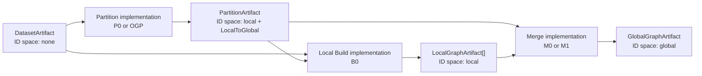
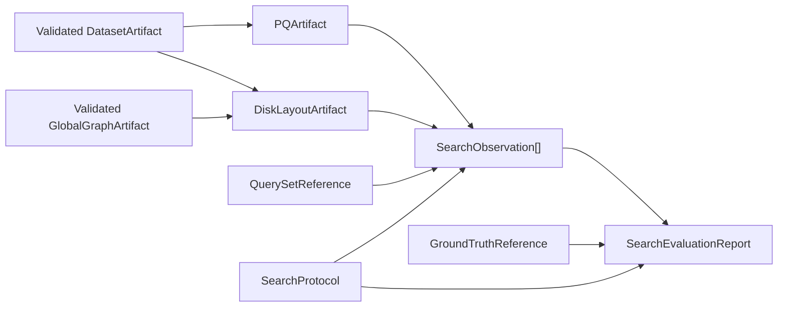
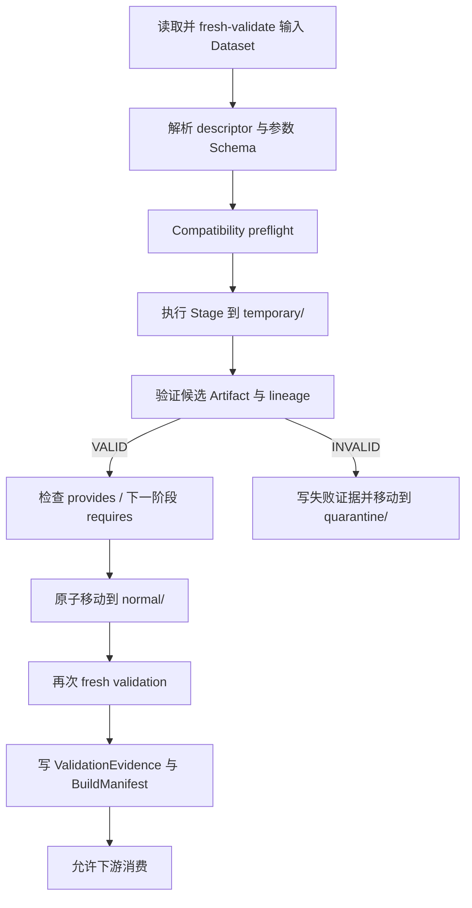

# 代码结构与设计说明

本文描述仓库当前真实代码结构及其设计边界，作为进入代码、添加论文实现和排查运行链路时的导航文档。具体算法语义仍以对应 Feature 的 `spec.md`、`source-mapping.md`、运行时契约以及固定上游源码为准。

## 1. 系统定位

项目把 DiskANN 的分片图构建拆成三个稳定阶段：

1. `Partition`：把全局数据集划分为可重叠的 Partition，输出完整的 Local-to-Global 映射。
2. `Local Build`：针对每个 Partition 构建 LocalNodeId 空间的局部图。
3. `Merge`：消费全部局部图及其映射，输出 GlobalNodeId 空间的全局图。

框架的重点不是把所有算法揉进一个实现，而是固定跨实现的契约、验证和证据生命周期，使 Baseline 阶段与论文阶段可以独立替换、组合和比较。



搜索评估独立位于图构建之后：



搜索资产使用现有 Artifact 验证设施，但 SearchProtocol、QuerySet、GroundTruth 和 SearchObservation 是 Feature 005 的私有对象；它们没有被伪装成新的公共图构建 Stage。

## 2. 设计依据与优先级

从高到低按以下顺序判断设计和实现：

1. 根目录 `AGENTS.md`：不可绕过的工程、实验和安全闸门。
2. `docs/source/framework.raw.txt`：总体架构与语义边界的原始设计依据。
3. `specs/<feature>/spec.md`、`plan.md`、`data-model.md`：单个 Feature 的需求和设计。
4. `specs/<feature>/source-mapping.md`：论文/上游符号到本仓库实现的绑定。
5. `contracts/`：实际运行时使用的格式、Schema 和契约规则。
6. `include/` 与 `src/`：公共 API 和当前实现。

对于固定 Baseline 的具体行为，必须同时回到：

- `upstream/diskann-cpp-main/` 中 commit `78256bbab4685e1774e78d331e081a153be26823` 的源码；
- `specs/002-cpp-main-upstream-baseline/source-mapping.md`。

不能只根据架构示意图或论文描述推断 Baseline 行为。

## 3. 仓库结构

```text
.
├── CMakeLists.txt                 # 顶层选项、固定依赖身份、源码/工具链采集
├── cmake/                         # 编译选项和各外部实现的构建接入
├── include/diskann_pipeline/      # 稳定的公共 C++17 API
├── src/
│   ├── core/                      # JSON codec、workspace、存储、隔离与解析
│   ├── registry/                  # implementation 注册、解析和兼容性检查
│   ├── validation/                # Schema/checksum/lineage/ID/图结构验证
│   ├── pipeline/                  # 三阶段执行、Artifact 复用和结构评估
│   ├── cli/                       # 公共 runner 协议和通用生产 runner
│   ├── baseline/cpp_main/         # 固定 upstream 的 P0/B0/M0 wrapper
│   ├── papers/
│   │   ├── gp_ann/ogp/            # GP-ANN OGP Partition 适配
│   │   └── hnsw_merger/vamana/    # HNSW-Merger Vamana Merge 适配
│   └── search/diskann/            # post-graph PQ、DiskLayout、搜索与评估
├── contracts/
│   ├── v1/                        # 公共运行时 Artifact/Manifest/Report 契约
│   ├── baseline-v1/               # 固定 cpp_main 参数/请求契约
│   └── papers/                    # 论文实现参数契约
├── harness/python/diskann_harness/# 配置归一化、preflight、runner 编排和报告聚合
├── tests/
│   ├── cpp/                       # unit/contract/property/integration/专项测试
│   ├── python/                    # Harness、Schema、治理和端到端测试
│   ├── cmake/                     # target 隔离和构建约束测试
│   └── fixtures/                  # Fake、小图和搜索夹具
├── specs/                         # 001–005 Feature 规范与验证记录
├── experiments/
│   ├── configs/                   # 人工声明的实验配置
│   ├── manifests/                 # 生成过程和运行身份
│   ├── artifacts/                 # 不可变数据产物
│   ├── reports/                   # 评估报告
│   └── results/                   # 聚合结果
├── loop_engine/                   # 当前未实现；不得视为已有调度能力
└── upstream/diskann-cpp-main/     # 固定、只读的上游子模块
```

`build/`、`cmake-build-debug/`、`.venv/` 和 `.pytest_cache/` 是本地生成目录，不属于架构源码。当前不需要为了目录齐全而向空的 `loop_engine/` 或实验输出目录添加占位实现。

## 4. 公共 C++ API

`include/diskann_pipeline/` 是实现之间共享的最小稳定表面。

| API 组 | 主要文件 | 职责 |
|---|---|---|
| 标识与引用 | `identifiers.hpp`, `artifact_ref.hpp` | Node/Partition ID、Artifact 类型、ID 空间、轻量引用 |
| 数据模型 | `artifacts.hpp`, `provenance.hpp`, `evaluation.hpp` | Artifact 元数据、BuildManifest、ValidationEvidence、EvaluationReport |
| 插件契约 | `implementation.hpp`, `stage_interfaces.hpp` | descriptor、factory、三个 Stage 接口 |
| 运行时服务 | `stage_context.hpp`, `workspace.hpp` | 向量、距离、预算、取消、指标、临时目录和路径约束 |
| 选择与预检 | `registry.hpp`, `compatibility.hpp` | 注册封装、`requires`/`provides` 链路检查 |
| 执行与复用 | `pipeline.hpp`, `reuse.hpp` | 三阶段编排、merge-only、复用和执行结果 |
| 验证与隔离 | `validation.hpp`, `quarantine.hpp`, `stores.hpp` | fresh validation、不可变证据、失败候选隔离 |
| 进程协议 | `runner_protocol.hpp`, `document_codec.hpp` | JSON 请求/结果和对象序列化 |

公共接口只传递 `ArtifactRef`，不在实现边界之间传递完整图对象。这样做让产物可以独立校验、复用和审计，也避免 C++ 内存对象成为隐式数据契约。

## 5. 公共内核的职责分层

### 5.1 `src/core`

- 负责 JSON 编解码、工作区创建、路径 confinement 和不可变写入；
- 分别持久化 BuildManifest、ValidationEvidence、EvaluationReport；
- 解析 Artifact 引用和 lineage；
- 把无效候选从临时区移动到 quarantine，而不是让其进入正常产物区。

工作区固定分为：

```text
<workspace>/
├── normal/       # 已验证并正式发布的 Artifact
├── temporary/    # Stage 私有候选和临时文件
├── manifests/    # BuildManifest 与 ValidationEvidence
├── reports/      # EvaluationReport / Feature-local 报告
└── quarantine/   # 无效候选及其失败证据
```

### 5.2 `src/registry`

每个实现通过 `ImplementationDescriptor` 声明：

- `implementation_id` 与版本；
- 所属 `StageKind`；
- 输入 Artifact 类型、可接受版本和 ID 空间；
- `required_capabilities` 与 `required_services`；
- 输出类型、版本、ID 空间和 capabilities；
- 参数 Schema 路径。

Registry 有明确的 production/test admission policy，完成注册后调用 `seal()`，运行期间不能再修改。CompatibilityChecker 在昂贵任务开始前检查整条实现链。

### 5.3 `src/validation`

Validator 是 Artifact 进入下游的硬闸门，主要检查：

1. 引用类型与格式版本；
2. metadata JSON Schema；
3. payload 路径 confinement、长度和 SHA-256；
4. canonical aggregate checksum；
5. Dataset 身份和 source lineage；
6. Local-to-Global 映射完整性与范围；
7. 图节点数、邻居 ID、degree 上限和 ID 空间；
8. Artifact 特定 native payload 结构。

验证通过后才构造 `ValidatedArtifact`。验证失败只产生 `ValidationEvidence` 和 quarantine 记录，不能进入复用、Merge、搜索或结果聚合。

### 5.4 `src/pipeline`

`PipelineExecutor` 是三个 Stage 的唯一公共编排器，支持：

- 完整 `Partition -> Local Build[] -> Merge`；
- 复用一个已 fresh-validated 的 PartitionArtifact；
- 只消费既有 Partition/LocalGraph 的 merge-only 运行；
- 每阶段参数 Schema 校验；
- 每阶段独立 BuildManifest；
- 候选验证、实现 handoff 检查、原子发布和失败隔离；
- 对最终已验证 GlobalGraph 生成独立结构 EvaluationReport。

执行顺序是 fail-closed 的：



## 6. 实现插件

### 6.1 固定 `cpp_main` Baseline

`src/baseline/cpp_main/` 在仓库外层包装固定 upstream，可注册三个实现：

| Stage | Implementation | 输出 |
|---|---|---|
| Partition | `..._p0_callable_v1` | Local ID 空间的 PartitionArtifact |
| Local Build | `..._b0_callable_v1` | LocalGraphArtifact |
| Merge | `..._m0_callable_v1` | GlobalGraphArtifact |

三个 implementation ID 都包含固定的 40 位 upstream commit。源码/构建 admission、参数 Schema、native format 转换和 runner 都位于 `upstream/` 之外。

M0 的语义仅包括：读取 Local-to-Global map、把 medoid/邻居转为 GlobalNodeId、聚合同一全局节点的候选、去重、随机打乱、截断到 `R`、写出全局图。它不做向量距离重算、RobustPrune、global refinement、连通性检测或修复。

### 6.2 GP-ANN OGP

`src/papers/gp_ann/ogp/` 只替换 Partition：

- 固定官方仓库/分支/commit；
- 通过独立 out-of-tree 官方二进制运行 OGP；
- 解析和规范化 cluster 输出；
- 适配为标准 Local ID 空间 PartitionArtifact；
- 与已有 B0、M0 组合运行。

论文适配保留独立 `implementation_id`、源码身份、参数 Schema 和 Stage-owned execution manifest，不冒充 Baseline P0。

### 6.3 HNSW-Merger Vamana M1

`src/papers/hnsw_merger/vamana/` 只替换 Merge：

- 消费标准 PartitionArtifact 与全部 LocalGraphArtifact；
- 需要 vector accessor 和 L2 distance service；
- 使用冻结的 `R=16`、`alpha=1.2`、`max_candidate_size=750` 等配置；
- 输出标准 GlobalGraphArtifact；
- 通过 merge-only 模式与 M0 复用完全相同的输入做结构对比。

它的 reproduction mode 是 faithful adaptation，不应描述为 upstream-faithful M0。

### 6.4 搜索评估

`src/search/diskann/` 提供固定的 post-graph 能力：

- 从 Dataset 生成 `PQArtifact/v1`；
- 从 Dataset + GlobalGraph 生成 `DiskLayoutArtifact/v1`；
- 对 PQ/DiskLayout 做 native 格式和可加载性检查；
- 分别运行 upstream oracle 与 instrumented PQFlash 搜索；
- 保存逐点 SearchObservation，并离线生成 SearchEvaluationReport。

PQ 只绑定 Dataset；DiskLayout 精确绑定 Dataset 和一个 GlobalGraph。GroundTruth 不参与搜索执行，只在离线评估时参与质量计算，因此 GroundTruth 变化不会使既有原始搜索观测失效。

## 7. Runner 与 Python Harness

本仓库刻意没有把所有实现塞进一个全局生产 Registry。

| 入口 | 装配内容 | 用途 |
|---|---|---|
| `diskann_pipeline_runner` | 当前 production Registry 为空 | 公共协议、validate/evaluate/registry 表面；Feature 001 不提供真实 Stage |
| `cpp_main_baseline_runner` | P0 + B0 + M0 | 固定 Baseline 执行 |
| `ogp_experiment_runner` | OGP + B0 + M0 | OGP Partition 组合实验 |
| `hnsw_merger_experiment_runner` | M0 + M1 merge-only | 相同输入的 Merge 对比 |
| `diskann_search_evaluation_runner` | PQ/Layout/native search 操作 | GlobalGraph 下游搜索评估 |

`harness/python/diskann_harness/` 是进程级编排层：

1. 安全读取 YAML/JSON，拒绝重复 key 和非 JSON 值；
2. 归一化工作区和配置；
3. 校验 RunRequest/Feature-local Schema；
4. 执行 source/build/data preflight；
5. 以 `shell=False` 启动对应 C++ runner；
6. 核对进程退出码和 immutable RunnerResult；
7. 保留每次运行、失败、排除和聚合证据。

C++ 负责 native 算法调用、Artifact 候选和底层验证；Python 负责声明归一化、跨进程控制和实验级聚合。两层通过文件与 JSON 协议衔接，不使用 Python/C++ 进程内绑定。

## 8. Artifact、Manifest、Evidence 与 Report

这四类对象不能混用：

| 对象 | 回答的问题 | 典型内容 | 禁止混入 |
|---|---|---|---|
| Artifact | 数据是什么 | payload、结构元数据、checksum、lineage | 运行性能和评价结论 |
| BuildManifest | 如何生成/执行 | 源码、工具链、参数、输入输出、预算、状态 | Artifact 数据本体 |
| ValidationEvidence | 是否满足结构契约 | checks、失败类别、候选身份 | Recall/QPS 等质量结论 |
| EvaluationReport | 数据质量/性能如何 | 图结构发现或搜索指标与资格 | 生成过程替代信息 |

公共 Artifact ID 空间如下：

| Artifact | ID 空间 | 关键约束 |
|---|---|---|
| DatasetArtifact | `none` | Dataset 身份和向量 payload 固定 |
| PartitionArtifact | `local` | 每个 Partition 有完整 LocalToGlobal 映射 |
| LocalGraphArtifact | `local` | 节点与邻居均为该 Partition 的 LocalNodeId |
| GlobalGraphArtifact | `global` | 不得残留 LocalNodeId，逻辑节点数等于 Dataset |
| PQArtifact | `none` | 只以 Dataset 为 source |
| DiskLayoutArtifact | `global` | Dataset 行与图记录保持 GlobalNodeId 顺序 |

使用论文私有 ID 或存储布局时，必须由显式、可版本化、可测试的 Adapter 转换，不能在公共 Validator 或其他实现中静默改语义。

## 9. 构建目标与开关

顶层 CMake 默认构建公共 core、通用 runner 和公共测试；真实实现按开关接入：

| CMake 选项 | 增加的主要能力 |
|---|---|
| `DISKANN_CPP_MAIN_BASELINE=ON` | 固定 upstream、P0/B0/M0、Baseline runner/tests |
| `DISKANN_GP_ANN_OGP=ON` | 官方 GP-ANN OGP Partition 和组合 runner/tests |
| `DISKANN_HNSW_MERGER=ON` | Vamana M1 Merge 和对比 runner/tests |
| `DISKANN_SEARCH_EVALUATION=ON` | PQ/DiskLayout/Search runner/tests；同时要求 Baseline 开关 |

Linux 是正式实验平台。搜索的 native OpenMP/AVX2/libaio 路径由平台条件控制；macOS 主要用于公共契约、Fake、小图和非正式开发验证，不能替代规范要求的 Linux 性能环境。

## 10. 测试结构

测试不是按源码目录机械镜像，而是按证据类型分层：

- `tests/cpp/unit/`：Registry、StageContext、workspace 等局部行为；
- `tests/cpp/contract/`：Schema codec、checksum、Artifact 和 Adapter 契约；
- `tests/cpp/property/`：小图 ID、degree、非法图性质；
- `tests/cpp/integration/`：preflight、编排、复用、quarantine、失败闸门；
- `tests/cpp/baseline/`：P0/B0/M0 和固定源码/构建 admission；
- `tests/cpp/papers/`：OGP 与 M1 的论文专项行为；
- `tests/cpp/search/`：post-graph 物化、PQFlash 观测和 parity；
- `tests/python/`：Schema 同步、Harness、治理、实验请求与端到端证据；
- `tests/cmake/`：生产/Fake target 隔离和 out-of-tree 构建约束。

修改应从最小相关测试开始，再根据语义影响扩展到契约、集成、小图、Baseline parity 或 SIFT1M。编译成功不能替代行为测试。

## 11. 当前实现状态与边界

截至本文整理时：

- 公共三阶段框架、契约、验证、复用、隔离和 Fake 测试设施已存在；
- 固定 cpp_main P0/B0/M0 wrapper 已实现，SIFT1M unified structural validation 有保留记录；
- Baseline 的正式 structural/contract parity Gate 仍为 `NOT_REACHED`，因此不能声称最终 Framework Baseline 已认证；
- OGP Partition 和 HNSW-Merger M1 Merge 适配代码已存在；M1 的相同输入结构报告不包含查询质量评估；
- post-graph PQ、DiskLayout、搜索观测与离线评估代码已存在；正式 SIFT1M 搜索仍受 Feature 005 的人工边界与环境 Gate 约束；
- `loop_engine/` 当前为空，参数矩阵、checkpoint、自动重试和调度不能被当作现有能力；
- 各 Feature 文档中的 `Status: Draft`、任务勾选和运行报告分别表示规范状态、实现记录和实验事实，三者不能互相替代。

## 12. 后续扩展规则

### 添加新的 Partition / Local Build / Merge

1. 新建或复用唯一 Feature spec；
2. 固定论文/源码身份并建立 `source-mapping.md`；
3. 定义独立 implementation ID、reproduction mode 和参数 Schema；
4. 声明完整 `requires`/`provides`；
5. 只通过标准 Artifact 或显式 Adapter 接入；
6. 添加单元、契约、小图性质和组合测试；
7. 先通过 SIFT1M 和人工 diff 审查，再考虑更大数据集。

### 添加新的 Artifact 格式

必须同时更新：

- Feature 设计 Schema 与 `contracts/*/SOURCES.json`；
- 运行时 Schema/version；
- C++ 数据投影和 codec；
- canonical checksum；
- Validator 和 lineage 规则；
- Registry capability；
- Adapter（若存在）；
- 正向、负向和 source-sync 测试。

破坏性变更必须升级格式版本，不能让旧 Artifact 被新代码按新语义静默读取。

## 13. 结构整理建议

当前源码目录已经与架构职责基本一致，不建议为了视觉整齐移动实现文件。更值得优先做的是：

1. 保持本 README 和本文作为稳定入口，减少从多个 Draft spec 猜当前结构；
2. 后续单独维护一份 Feature 状态索引，明确“实现、验证、正式 Gate”三个状态；
3. 若公共 core 继续增长，再通过独立 Feature 评估把 Baseline/Search native format 代码从 `diskann_pipeline_core` 的固定 source list 中拆为内部库；
4. 只有在 Loop Engine 的 spec、契约和审批边界明确后，才填充 `loop_engine/`；
5. 继续保留专用 runner 的装配边界，除非有明确需求和测试证明统一生产 Registry 不会混淆 reproduction identity。

这些建议都不要求修改只读 upstream，也不改变当前算法或实验语义。
